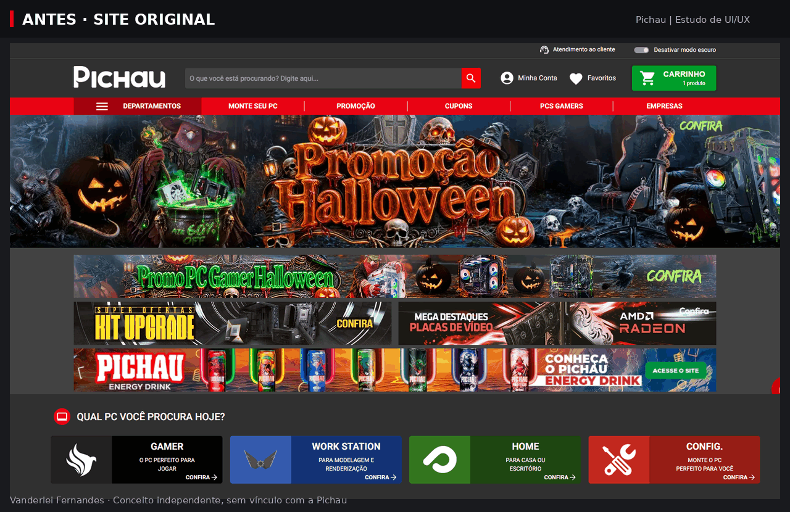

# Pichau — conceito de redesign

Redesign independente de uma loja gamer, desenvolvido como projeto de estudo com foco em front-end, UI/UX e experiência de compra responsiva.

A interface reúne campanhas, vitrines de produtos, busca, filtros, favoritos, carrinho e um checkout demonstrativo.

**[Acessar o site](https://vanderleifernandesds.github.io/pichau-redesign/)**

> Projeto de estudo, sem vínculo comercial com a Pichau. Produtos, preços e avaliações são ilustrativos. Nenhuma compra ou cobrança é realizada. Login e cadastro são demonstrações, sem autenticação real.

## Objetivo

Praticar a construção de uma interface de e-commerce com React, combinando identidade visual gamer, organização do catálogo e feedback nas principais interações.

O projeto explora a adaptação da navegação para desktop e mobile, a apresentação das informações de produto e o gerenciamento de estado compartilhado entre vitrines e painéis.

## Referência original e proposta de redesign

Comparação entre a interface original da Pichau e minha proposta independente de redesign.



A proposta reorganiza a primeira tela em torno de uma campanha principal, unifica a linguagem visual dos componentes e apresenta categorias por objetivo de uso.

As mudanças representam decisões de design exploradas neste projeto de estudo. Seus efeitos na usabilidade e na conversão não foram medidos.

## Tecnologias

- **React 19** — componentes e gerenciamento de estado.
- **Vite 8** — ambiente de desenvolvimento e build.
- **Tailwind CSS 4** — estilização e responsividade.
- **Lucide React** — ícones.
- **GitHub Actions e GitHub Pages** — build e publicação.

As fontes Inter e Rajdhani são servidas localmente.

## Decisões de UI/UX

- **Navegação adaptada ao dispositivo:** cabeçalho com busca e ações no desktop; barra inferior com atalhos no mobile.
- **Hierarquia de preços:** valor no Pix em destaque, seguido das condições de parcelamento e do total no cartão.
- **Exploração por objetivo:** cards para PC Gamer, Trabalho e criação, Casa e escritório e Monte seu PC.
- **Feedback nas ações:** contadores, mensagens de estado e opção de desfazer a remoção de produtos.
- **Avaliações contextualizadas:** notas ilustrativas identificadas e estado “Sem avaliações” quando não há nota.
- **Consistência visual:** temas claro e escuro, tipografia compartilhada e componentes com cantos chanfrados.

## Funcionalidades

### Navegação e campanhas

- Cabeçalho com busca, alternância de tema, acesso à conta, favoritos e carrinho.
- Barra inferior no mobile com Menu, Busca, Monte seu PC, Favoritos e Carrinho.
- Menu de departamentos com categorias e subcategorias.
- Carrossel de campanhas com setas, indicadores e controle de pausa.
- Cards de navegação por objetivo.

### Catálogo

- Vitrines com filtro por categoria.
- Busca por nome e especificações.
- Adição e remoção de favoritos.
- Avaliações por estrelas, com preenchimento proporcional à nota.

### Carrinho

- Alteração de quantidade e remoção de produtos.
- Opção de desfazer remoções.
- Cálculo do total.
- Fluxo demonstrativo de checkout.

### Conta e atendimento

- Telas demonstrativas de entrar e criar conta.
- Central de ajuda.
- Rodapé com links para os canais oficiais de atendimento da Pichau.

## Simulações e limitações

O projeto não depende de backend, autenticação ou serviços de pagamento.

| Recurso | Comportamento |
| --- | --- |
| Checkout | Simulação em etapas, sem solicitar dados pessoais ou de pagamento. |
| Entrar e criar conta | Formulários com validação dos campos; os dados não são enviados ou salvos e nenhuma sessão é criada. |
| Newsletter | Validação do e-mail e limpeza do campo, sem envio ou inscrição. |
| Avaliações | Notas ilustrativas identificadas nos cards. Produtos sem nota exibem “Sem avaliações”. |
| Página do produto | Ainda não implementada; apresenta um aviso de recurso indisponível. |
| Cupons e departamentos sem produtos | Apresentam um aviso de recurso indisponível. |

## Persistência local

Carrinho, favoritos e preferência de tema são armazenados no `localStorage` do navegador:

| Dado | Chave |
| --- | --- |
| Carrinho | `pichau-demo-cart` |
| Favoritos | `pichau-demo-favorites` |
| Tema | `pichau-theme` |

Esses dados ficam no navegador utilizado, sem sincronização entre dispositivos. Se o armazenamento estiver indisponível, o site continua funcionando em memória.

## Executar localmente

### Pré-requisitos

- Node.js 20.19+ ou 22.12+ (versões mais novas também funcionam).
- npm.

### Instalação

```bash
git clone https://github.com/VanderleiFernandesds/pichau-redesign.git
cd pichau-redesign
npm ci
npm run dev
```

O endereço padrão de desenvolvimento é:

http://localhost:5173/pichau-redesign/

A porta pode mudar se já estiver em uso; confira o endereço informado pelo terminal.

### Build de produção

```bash
npm run build
```

Os arquivos gerados ficam em `dist/`.

Para visualizar o build localmente:

```bash
npm run preview
```

Endereço padrão do preview:

http://localhost:4173/pichau-redesign/

O projeto não exige variáveis de ambiente.

## Publicação

O projeto utiliza o caminho base `/pichau-redesign/` no Vite para funcionar no subdiretório do GitHub Pages.

Cada push na branch `main` dispara o workflow [deploy.yml](.github/workflows/deploy.yml), que:

1. Instala as dependências com `npm ci`.
2. Executa `npm run build`.
3. Publica a pasta `dist/` no GitHub Pages.

O workflow também pode ser iniciado manualmente pela aba **Actions**.

> Alterações locais só aparecem no site publicado depois de serem enviadas à `main` e de o deploy terminar com sucesso.

## Estrutura do projeto

```text
src/
├── assets/
│   ├── fonts/              Inter e Rajdhani servidas localmente
│   └── images/             Banners, categorias, logos, produtos e cards de objetivo
├── components/
│   ├── account/            Acesso à conta e formulários demonstrativos
│   ├── cart/               Carrinho e etapas do checkout
│   ├── help/               Central de ajuda
│   ├── layout/
│   │   ├── header/         Cabeçalho, busca e departamentos
│   │   ├── footer/         Rodapé, contatos e newsletter
│   │   └── MobileNavBar    Navegação inferior do mobile
│   ├── products/           Cards e vitrines de produtos
│   └── ui/                 Modal, Toast, EmptyState, StarRating e outros
├── pages/home/             Estado e seções da página inicial
├── data/                   Produtos, categorias, campanhas e rodapé
├── hooks/                  Carrinho, favoritos, tema e interações
├── utils/                  Formatação, validação e armazenamento
├── App.jsx                 Providers e composição principal
├── main.jsx                Ponto de entrada
└── index.css               Tokens de tema e estilos compartilhados
```

Carrinho e favoritos são instanciados na `HomePage` e compartilhados por props entre o cabeçalho, as vitrines e os painéis.

## Acessibilidade e responsividade

A implementação inclui:

- Layouts adaptados para telas pequenas e grandes.
- Link “Pular para o conteúdo”.
- Foco visível e suporte à navegação por teclado.
- Uso de `<dialog>` nos modais e painéis, com tratamento de foco e fechamento.
- Nomes acessíveis em botões que exibem apenas ícones.
- Regiões `aria-live` para comunicar atualizações.
- Mensagens de erro associadas aos campos dos formulários.
- Respeito à preferência `prefers-reduced-motion`.
- Aplicação da preferência de tema antes da primeira pintura.

Esses recursos não substituem uma auditoria completa de acessibilidade.

## Autor

Desenvolvido por **Vanderlei Fernandes** como projeto de estudo e portfólio.

[GitHub](https://github.com/VanderleiFernandesds)